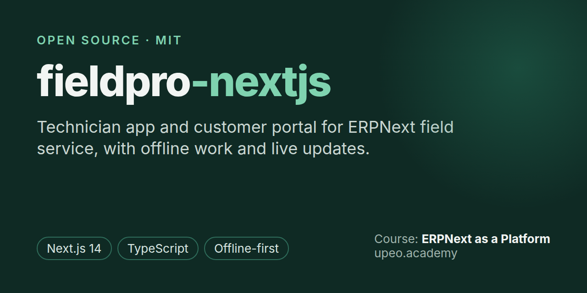

# fieldpro-nextjs: technician app and customer portal for ERPNext field service




[](https://www.upeo.academy/courses/erpnext-as-platform-course)

**fieldpro-nextjs** is the open-source front end of fieldpro, a field service management system
built on [Frappe](https://frappe.io/framework) and [ERPNext](https://erpnext.com). One Next.js app
holds two products:

- **Technician app (`/tech`):** sign in with a one-time code, see today's jobs, start and end
  visits, add parts and photos, capture the customer's signature, and keep working offline.
- **Customer portal (`/portal`):** book a job, follow it live, accept or reject finished work and
  download the job card.

The backend is [fieldpro-frappe](https://github.com/karani-gk/fieldpro-frappe). Both are the code
you build in UPEO Academy's course
**[ERPNext as a Platform](https://www.upeo.academy/courses/erpnext-as-platform-course)**.

## Contents

- [Features](#features)
- [Quick start](#quick-start)
- [How it talks to the backend](#how-it-talks-to-the-backend)
- [Offline (technician app)](#offline-technician-app)
- [Live updates and push](#live-updates-and-push)
- [Project structure](#project-structure)
- [FAQ](#faq)

## Features

- **Offline-first technician app:** work done with no signal waits in an outbox and syncs when the
  connection returns. Nothing is lost and nothing is applied twice.
- **Live job status:** socket.io updates from Frappe, so screens change as soon as a job does.
- **Web push** through Firebase Cloud Messaging (optional).
- **Two sign-in patterns side by side:** an API token for the technician app (the mobile pattern)
  and a session cookie with CSRF for the portal (the browser pattern).
- **One origin:** the app proxies the backend, so cookies stay first-party and there is no CORS.
- **Typed API client:** `src/lib/types.ts` mirrors the backend's response shapes.

## Quick start

**Requirements:** Node.js 22.6 or newer, and a running
[fieldpro-frappe](https://github.com/karani-gk/fieldpro-frappe) backend with its demo data.

```bash
git clone https://github.com/karani-gk/fieldpro-nextjs.git
cd fieldpro-nextjs
cp .env.example .env.local   # where the backend is
npm ci
npm run dev                  # http://localhost:3030
```

The first time, the sign-in pages point to http://localhost:3030/activate: paste the access code
from your [ERPNext as a Platform](https://www.upeo.academy/courses/erpnext-as-platform-course)
course email. An installation is activated once, for everyone.

Open http://localhost:3030/tech and sign in as a demo technician (`+254700100001`), or
http://localhost:3030/portal as a demo customer (`clinic@fieldpro.test`, password
`fieldpro-demo`). Locally the technician's one-time code is in the backend's Desk under
**SMS Log**.

Checks:

```bash
npm test                     # unit tests (Node's test runner)
npm run typecheck && npm run lint
npm run build                # stop the dev server first: both use .next
```

## How it talks to the backend

- **One origin.** `next.config.mjs` proxies `/api`, `/private/files` and `/socket.io` to Frappe, so
  the browser never leaves this origin: first-party cookies, no CORS.
- **One file.** `src/lib/api.ts` is the only code that calls the backend. Screens call its functions.
- **Two ways to sign in.** The technician app sends a token on every call and no cookies. The portal
  uses Frappe's session cookie and adds the CSRF token to every POST.
- **One error type.** `src/lib/errors.ts` turns fieldpro's error format and Frappe's own into `ApiError`.
- **Server and browser.** The landing page (`src/app/page.tsx`) is fetched on the server. Signed-in
  screens fetch in the browser, with the user's own token or cookie.

## Offline (technician app)

Work done with no signal (start a visit, add a part, end a visit) goes into an outbox in
`localStorage` (`src/lib/offline/queue.ts`) with a `client_id` made on the phone.
`src/lib/offline/sync.ts` pushes it in batches when the connection returns (and every minute),
then pulls what changed since the server's cursor. A batch sent twice is applied once. If the
server says no (the job was cancelled meanwhile), the server wins and the technician is told. The
header always says what is saved and what is synced.

## Live updates and push

`src/lib/realtime.ts` subscribes to the backend's `fieldpro_job` events over socket.io
(long-polling through the proxy; `src/middleware.ts` explains the Origin header it adds).
`src/lib/push.ts` registers for Firebase web push when the `NEXT_PUBLIC_FIREBASE_*` settings are
filled in; without them the app runs without push.

## Project structure

| Path | What is there |
|---|---|
| `src/app/tech/` | Technician app: sign-in, today's jobs, a job, my week; `TechProvider.tsx` holds auth, sync and live state |
| `src/app/portal/` | Customer portal: sign-in, my jobs (live), book a job, a job (accept or reject, job card) |
| `src/lib/` | `api.ts`, `errors.ts`, `types.ts` (the API contract), `offline/`, `realtime.ts`, `push.ts`, `format.ts` |
| `src/app/activate/` | Activating the installation with the course access code (once) |
| `src/components/` | Status badge, error note, signature pad, private image, activation gate |
| `tests/` | Unit tests for the error format and the outbox |

Every pattern here (token storage, outbox and client ids, cursor sync, server-owned workflow
actions) works the same way in a Flutter or React Native app.

## FAQ

**What is fieldpro-nextjs?**
The open-source technician app and customer portal for fieldpro, a field service management
system on Frappe and ERPNext v16, written in Next.js 14 and TypeScript.

**Does it work without the backend?**
No. It needs [fieldpro-frappe](https://github.com/karani-gk/fieldpro-frappe) running on Frappe and
ERPNext v16.

**Does the technician app work offline?**
Yes. Visits, parts and sign-offs recorded with no signal are queued on the device and synced
later, each applied exactly once.

**Can I build the mobile app in Flutter or React Native instead?**
Yes. The backend API is client-neutral; this app shows the patterns any mobile client needs.

**Is it free?**
Yes, the code is free and open. The course that teaches it,
[ERPNext as a Platform](https://www.upeo.academy/courses/erpnext-as-platform-course), is sold by
UPEO Academy.

## Related

- [fieldpro-frappe](https://github.com/karani-gk/fieldpro-frappe): the Frappe and ERPNext backend.
- [ERPNext as a Platform](https://www.upeo.academy/courses/erpnext-as-platform-course): the
  course, from UPEO Academy.

## License

[MIT](LICENSE), © 2026 Upeosoft.
